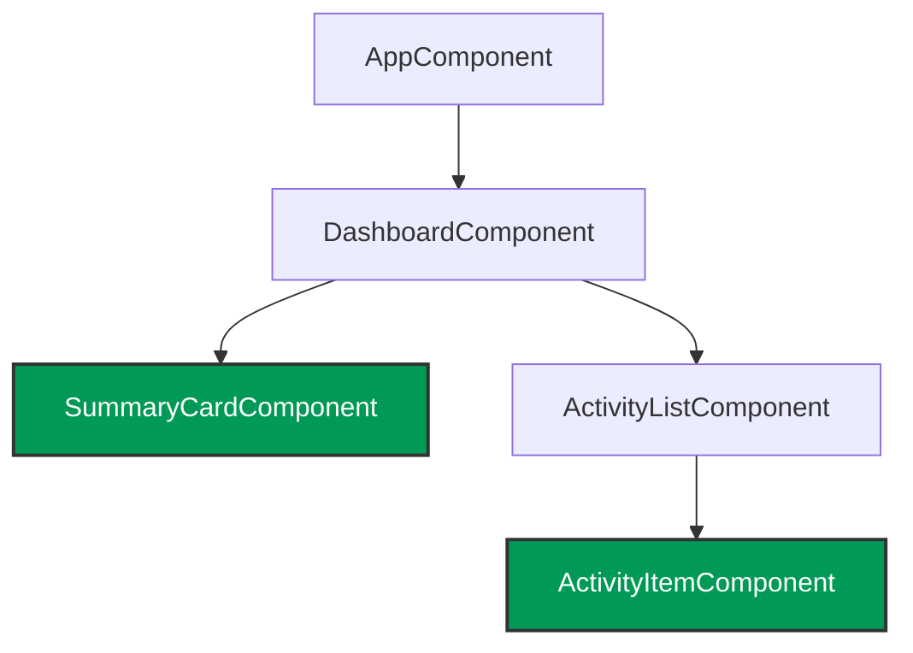

<div align="center">
  

  <h1>Angular Outliner</h1>

  <p><strong>See the Angular components behind your screen.</strong></p>

  <p>A Chrome extension that draws component boundaries directly on your running app—so you can explore unfamiliar code, inspect layouts, and explain changes visually.</p>

  <p>
    <a href="#quick-start">Get started</a> ·
    <a href="https://youtu.be/NUdmr3CRHuE">Watch the demo</a> ·
    <a href="#features">Explore features</a> ·
    <a href="https://github.com/felikf/angular-outliner/issues">Report an issue</a>
  </p>

  <p>
    
    
    
  </p>
</div>


## Understand your UI at a glance

A screen tells you what an application looks like. Angular Outliner helps you see how it is built.

Highlight your application components, isolate a UI library, or find every instance of a specific component. Connect what you see in the browser with the component names you work with in your editor.

- **Get oriented in a new project.** Discover which components make up the current page.
- **Inspect component boundaries.** See where components start, end, and overlap.
- **Give code reviews visual context.** Add an annotated screenshot or component diagram to your pull request.
- **Explain architecture to your team.** Turn the current page's component hierarchy into a Mermaid flowchart.

## Features

| Feature | What it helps you do |
| --- | --- |
| **Component outlines** | Draw colored borders and labels around components on the page. |
| **Namespace selection** | Highlight groups by selector prefix, such as `app` for application components or `mat` for Angular Material. |
| **Individual component selection** | Focus on the component types relevant to your task. |
| **Search and sorting** | Filter by class name or selector, then sort by name or instance count. Matching components are automatically selected. |
| **Instance counts** | See how many instances of each component type are present on the current page. |
| **Change detection indicators** | Identify components using `OnPush` or the default change detection strategy. |
| **Display controls** | Customize outline colors, switch between class names and selectors, and move labels to the top left or top right. |
| **Mermaid diagrams** | Copy a component hierarchy as Markdown, with `OnPush` components highlighted. |

### See it in action

[Watch the video walkthrough on YouTube →](https://youtu.be/NUdmr3CRHuE)


## Quick start

### Requirements

- **Google Chrome** with Developer mode enabled on the extensions page.
- **Node.js and npm** to build the extension from source.
- An **Angular application using Ivy**, running in **development mode**, with Angular's `ng` debug API available in the browser console.
- An application served from **`http://localhost` or `https://localhost`**. The manifest matches localhost across ports, including the usual `4200`.

The extension targets Angular 10+ development applications. Compatibility with every newer Angular release is not guaranteed; it depends on Angular's debug APIs and internals.

### 1. Build the extension

```bash
git clone https://github.com/felikf/angular-outliner.git
cd angular-outliner
npm install
npm run build
```

### 2. Load it into Chrome

1. Open `chrome://extensions/`.
2. Enable **Developer mode**.
3. Click **Load unpacked** and select the repository's **`dist`** folder.
4. Pin **Angular Component Overview**—the extension's name in Chrome—to your toolbar.

### 3. Explore your application

1. Start your Angular application in development mode and open its localhost URL.
2. Refresh the application tab after installing the extension.
3. Click the extension icon to open the popup.
4. Turn on **Enable tracing**, then select a namespace or individual components.
5. Use the filter to narrow your selection and adjust labels or colors as needed.

**Try this first:** select `app` to see your application's components, then switch to `mat` to inspect Angular Material components.

## Share your component architecture

The popup includes a generated **Mermaid** snippet for the current page. Copy it into a Markdown file, GitHub pull request, or another Mermaid-enabled viewer to share the hierarchy with your team.

For example, a small component tree could look like this:



Highlighted nodes represent components using `OnPush` change detection.

## Tips and troubleshooting

### No components appear

- Confirm that the application is running on **localhost**. The bundled manifest does not match `127.0.0.1`, custom hostnames, or remote sites.
- Check that Angular is running in **development mode** and that `ng` is available in the browser console.
- Refresh the application tab after loading or reloading the extension, then reopen the popup.
- Make sure you have enabled tracing and selected a namespace or component.

### Outlines look collapsed or overlap

Component host elements without a useful layout box can produce unexpected outlines. Try the popup's **Set display block for all unset components** option. This changes component display behavior and may affect the page layout.

For new components, you can also configure Angular CLI to generate block-level hosts:

```json
{
  "schematics": {
    "@schematics/angular:component": {
      "displayBlock": true
    }
  }
}
```

Nested components may naturally overlap. Select fewer components or change the label position to make the view easier to read.

## Development

Run the extension build in watch mode:

```bash
npm run start
```

After changes are built, reload the extension at `chrome://extensions/` and refresh the application tab.

| Command | Purpose |
| --- | --- |
| `npm run start` | Build the Angular extension in development watch mode. |
| `npm run build` | Create a production build in `dist`. |
| `npm run clean` | Remove the Angular extension's build output. |

### React prototype

This repository also contains a separate React extension prototype. See its [setup and usage guide](./react-extension/README.md).

## Feedback and contributions

Found a bug or have an idea? [Open an issue](https://github.com/felikf/angular-outliner/issues) with your Angular and Chrome versions, steps to reproduce, and a screenshot when useful.

Pull requests are welcome. For larger changes, open an issue first to discuss the approach.

**If Angular Outliner helps you understand your app, [give the repository a star](https://github.com/felikf/angular-outliner) and share it with your team.**

---

Created by [Felix Fatka](https://github.com/felikf). License: MIT, as declared in [package.json](./package.json).
